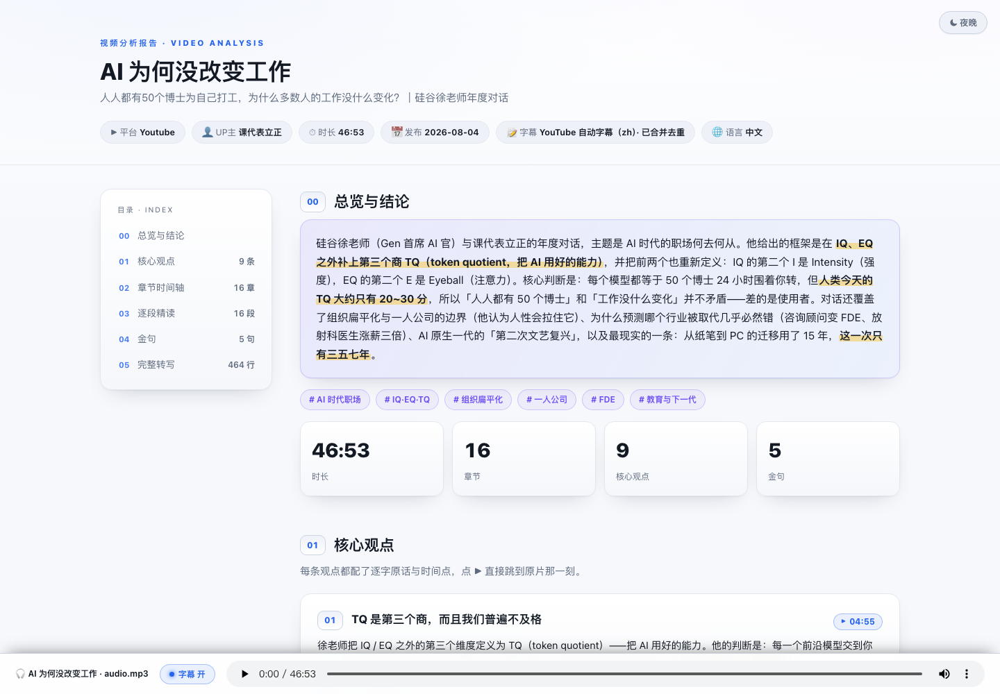
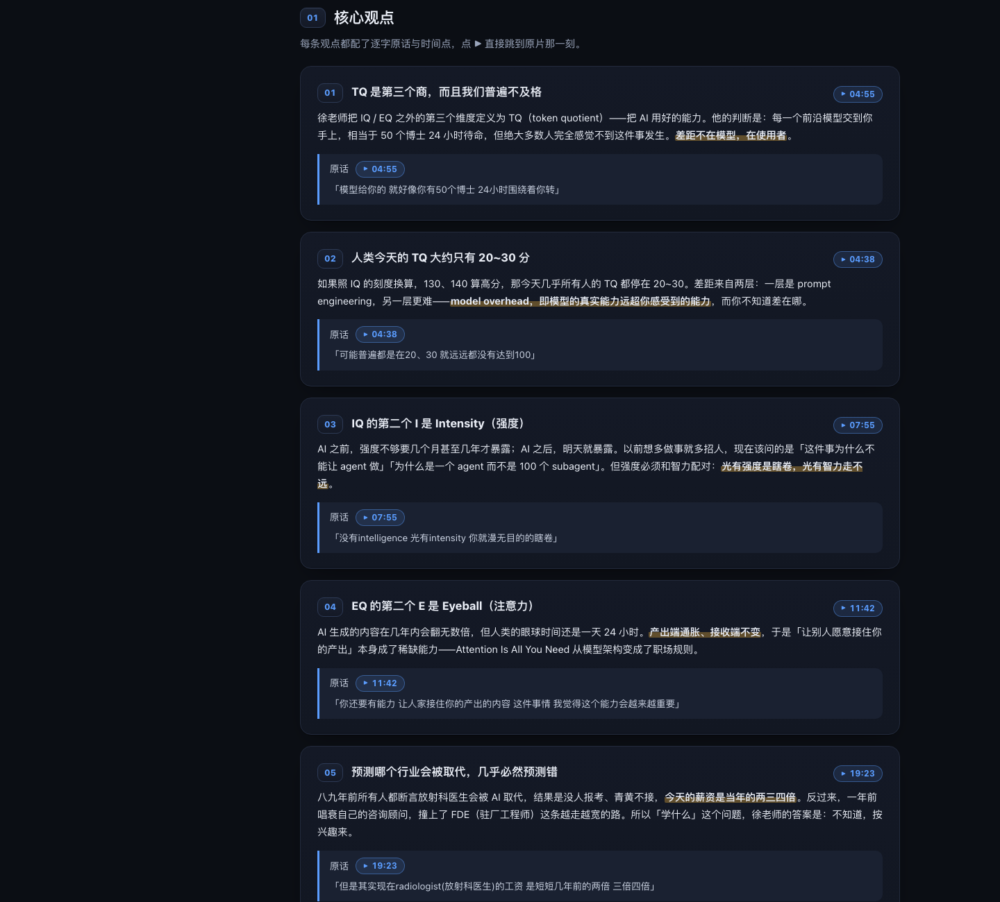

# video-debrief

把一个视频链接变成一份**可播放、可交互的 HTML 复盘报告**——每个时间点都是
`▶` 按钮，点了就跳回原片那一刻。

**[▶ 在线看一份真实报告（可点、可播）](https://gabrielpower1969.github.io/video-debrief/)**



核心观点区：每条观点都配了逐字原话和时间点，右上角一键切夜间/白天。



## 它做了什么

给它一个 YouTube / Bilibili 链接（或者一个音频文件、一份 `.srt`），它会：

1. **下载**音频（和平台字幕，如果有）
2. 没字幕就用 **Whisper 本地转写**，统一产出 SRT
3. 原文非中文时，**逐行翻译**出中文对照 SRT
4. **map-reduce 摘要**：概述 / 主题标签 / 核心观点 / 章节时间轴 / 金句
5. 渲染成单文件 `report.html`：左侧固定目录 + 底部播放条，观点、章节、
   逐段精读、金句、逐行转写全部带 `▶ mm:ss`，点击即跳到对应片段播放；
   播放时浮出**实时字幕条**（原文 + 译文），转写自动高亮当前行并滚动跟随；
   吃重的句子**标黄**，右上角切换**夜间 / 白天**（跟随系统，选择会记住）

语言规则：**原文中文 → 纯中文报告；原文英文（或其他语言）→ 原文 + 中文双语报告**。

它和普通 AI 摘要的区别只有一条：**报告里的每个论断，读者都能一键跳回原片求证。**
所以「时间戳只能抄不能编、引文一个字不许改」是这个 skill 的硬规则，不是建议。

## 怎么用

### A. Claude Code（插件市场，一行装上）

```bash
/plugin marketplace add GabrielPower1969/video-debrief
```

```bash
/plugin install video-debrief@gabriel-tools
```

装完直接说人话就行，不用记命令：

> 把 https://www.bilibili.com/video/BV1xxxx 做成复盘报告

### B. Claude.ai / Claude 桌面版（上传 skill 包）

1. 下载 **[video-debrief-skill.zip](https://github.com/GabrielPower1969/video-debrief/raw/main/dist/video-debrief-skill.zip)**
2. 打开 Claude 的 **Settings → Capabilities → Skills**，点 `+` → *Create skill* → 上传这个 zip
   （需要 Pro/Max/Team/Enterprise，并开启代码执行）
3. 把 `.srt` / `.vtt` 字幕文件拖进对话，说「做成复盘报告」

> ⚠️ 云端沙箱里没有 `yt-dlp`、也不能连外网下视频，所以这条路**只吃字幕/文本**。
> 想从链接一路跑到报告，用 A 或 C。

### C. 任意 agent（Codex / Cursor / Windsurf / 本地模型…）

skill 目录不依赖 Claude，任何能读写文件 + 执行命令的 agent 都能用：

```bash
git clone https://github.com/GabrielPower1969/video-debrief.git
```

然后把下面这段**原样贴给你的 agent**：

```text
读 video-debrief/skills/video-debrief/SKILL.md，严格按它的工作流和硬规则执行。

我的输入：<视频链接 / 音频文件路径 / .srt 文件路径>
产出目录：./out/

要点复述一遍，别跳步：
1. 先拿到带时间戳的转写（有 .srt 就直接用；只有链接就 yt-dlp 只下音频；
   只有媒体文件就本地 whisper 转写，不要上传到任何外部服务）。
2. 判定原文语言：中文出单语报告，非中文出「原文 + 中文译文」双语报告，
   逐行翻译必须保证行数对齐。
3. 转写按 ~9000 字符分片消化，每片划章节/摘原话/写纪要，再汇总成
   概述、主题、4~8 条核心观点、3~6 句金句。整篇一次性喂进去会丢中段。
4. 喂给模型的每行前缀成 [123s|02:03]，时间戳只能从这些标记里抄，禁止估算；
   引文逐字摘录，不许润色。
5. 按 skills/video-debrief/references/data-contract.md 组装 data.json，
   概述/观点/纪要里用 ==这句话== 标黄重点，引文和转写不标。
6. 渲染：python3 skills/video-debrief/scripts/render_report.py data.json out/report.html
   并把音频放到 report.html 同目录。
7. 最后检查覆盖率：转写最后一句离片尾超过 10% 就告警，别静默出一份只讲了开头的报告。
```

不想 clone 的话，让 agent 自己去读也行：
`https://raw.githubusercontent.com/GabrielPower1969/video-debrief/main/skills/video-debrief/SKILL.md`

### D. 一条命令跑完整条流水线（本地 Python）

需要 Python 3.10+。必须用 `.venv` 这个目录名——`./handle` 写死了用
`.venv/bin/python` 启动：

```bash
python3 -m venv .venv && .venv/bin/pip install -r requirements.txt
```

```bash
./handle "https://www.bilibili.com/video/BV1xxxx"
```

ffmpeg 不用单独装（走 `imageio-ffmpeg` 自带的静态二进制）。还需要 Anthropic
凭证：环境变量 `ANTHROPIC_API_KEY`，或 Claude Code 的登录态。

```bash
# 转写模型：tiny/base/small(默认)/medium/large-v3，越大越准越慢
./handle "https://..." --asr-model medium

# 平台字幕质量差，强制用 Whisper 重新转写
./handle "https://..." --force-asr

# 视频需要登录（如 B 站高清、会员视频）：借浏览器 cookie
./handle "https://..." --cookies-from-browser chrome

# 离线示例（不下载、不调 LLM，看看报告长什么样）
./handle --demo
```

## 输出

每个视频一个目录，目录名是 LLM 起的 5~10 字短标题：

```
output/<短标题>/
├── report.html        # 分析报告（打开即用，音频在旁边就能播放）
├── audio.mp3          # 音频
├── transcript.srt     # 原文字幕/转写
├── transcript.zh.srt  # 中文对照（原文非中文时才有）
└── data.json          # 报告的结构化数据
```

`report.html` 无外部依赖，配上同目录的 `audio.mp3` 可以整目录拷走分发；
单发 HTML 也能打开，只是播放器会隐藏、时间戳降级为纯展示。

## 仓库结构

```
skills/video-debrief/              # ← skill 本体，可以整个拿走单独用
├── SKILL.md                       # 触发条件、输入、工作流、硬规则
├── assets/report_template.html    # 单文件报告模板
├── references/
│   ├── data-contract.md           # REPORT_DATA 每个字段
│   └── design.md                  # 版式/配色/交互约定，改样式前读
└── scripts/
    ├── render_report.py           # data.json + 模板 → 单文件 HTML（纯标准库）
    └── srt_to_transcript.py       # SRT(+中文SRT) → transcript 数组

v2d/                               # 把整条流程自动化的 Python 实现（./handle）
.claude-plugin/                    # 插件清单 + 插件市场目录
docs/                              # GitHub Pages：在线 demo 报告 + 截图
dist/video-debrief-skill.zip       # 给 Claude.ai 上传用的 skill 包
```

skill 目录不依赖 `v2d/`：

```bash
python3 skills/video-debrief/scripts/srt_to_transcript.py a.srt --zh a.zh.srt > t.json
# 自己拼好 data.json 后
python3 skills/video-debrief/scripts/render_report.py data.json report.html
```

`v2d/report.py` 也是直接调它的 `render()`，所以两条路径产出的 HTML 完全一致。
改完 skill 记得 `./scripts/pack-skill.sh` 重新打包 zip。给别的 AI 编码工具用
见 [AGENTS.md](AGENTS.md)。

视觉语言脱胎于 [InterviewAnalysis](https://github.com/GabrielPower1969/InterviewAnalysis)
的 `interview-analysis` skill（MIT），按视频分析的内容模型重做了信息架构。

## 已知边界

- 下载依赖 `yt-dlp`，受平台风控影响；B 站部分视频需要 `--cookies-from-browser`
- Whisper 在 CPU 上跑 `small` 模型大约是视频时长的 0.5~1 倍时间
- 摘要/翻译走 Claude API，会产生 token 消耗（长视频按 ~9000 字符分片）
- 报告里含有原片的逐字转写。**自己看没问题，公开分发前请确认你有权这么做。**

## License

MIT
